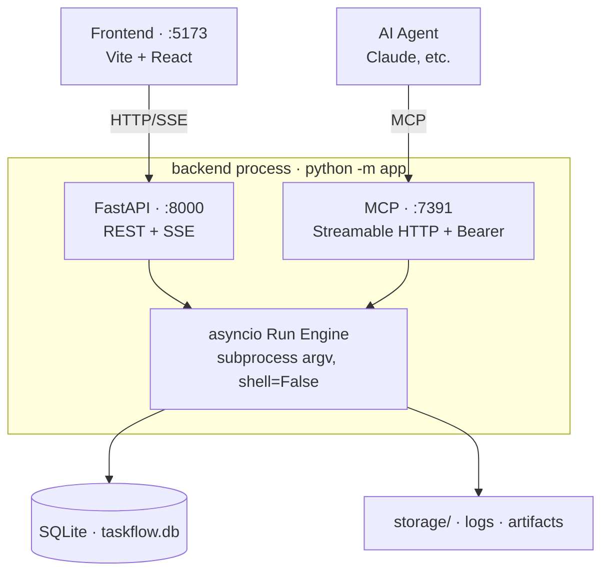

# TaskFlow MCP Server


**A workflow orchestration platform with AI Agents as primary users.** Scope-based permissions and hash-chained audit control agent execution, allowing Claude and other agents to safely run jobs through MCP (Model Context Protocol) endpoints.


## Architecture



The backend and the MCP server run in one process (`python -m app`) on separate ports, sharing one Run Engine and one log_bus. So a run started over MCP shows live in the UI Monitor and can be cancelled from the UI. MCP calls do not go through the REST API.

## Quickstart

```sh
git clone <this-repo> taskflow-mcp-server
cd taskflow-mcp-server
make setup        # venv + npm + DB migrate
make dev          # backend:8000 · mcp:7391 · frontend:5173
```

Open `http://localhost:5173` → `+ New Job` → Run. Starts with an empty DB — create jobs, keys, and artifacts directly through the UI or MCP.

For a detailed tutorial, see [Getting Started](./docs/getting-started.en.md).

Once a run starts, Monitor streams stdout in real time over SSE:


## Key Features

- **AI Agent First** — MCP endpoint lets agents trigger jobs directly; results returned as structured schema (`status`, `steps[]`, `failed_step`, `params`, `outputs`, `logs_uri`, etc.)
- **Run params** — a Job declares `params` (name · default · pattern) so each run can take values such as a branch; steps receive them as `PARAM_<NAME>` env vars, and the resolved values are pinned on the run ([Run Params](./docs/run-params.en.md))
- **Run outputs** — a step that prints `::output key=value` on stdout records the value on the run (`outputs`), so "the commit of the last successful deploy" is one `list_runs` call away ([Run Outputs](./docs/run-outputs.en.md))
- **Controlled execution** — `shell=False` (argv list only, no shell string is ever interpreted), controlled cwd (`TASKFLOW_STEP_CWD` default + per-step `cwd`), `cd`/`pushd`/`popd` rejected. A step's `cmd` is not restricted to a fixed set of commands and the Job-authoring REST API has no authentication — see [Security](./docs/security.en.md) for what that means
- **Observable** — Real-time stdout/stderr via SSE, output-text assertions for Step success/failure, Workflow DAG visualization (DAG · List · Timeline views)
- **Immutable audit** — Append-only hash-chained audit log; integrity verification via `/api/audit/verify`
- **MCP control** — Per-key scopes (`run:<job-id>` / `read:*` / `write:uploads`, etc.) + per-key per-minute rate-limit + issue/revoke audit trail

## Documentation

| Document | Contents |
|---|---|
| [Getting Started](./docs/getting-started.en.md) | Installation · First job · Step working directory (cwd) |
| [Artifacts](./docs/artifacts.en.md) | Upload · Declaring aliases on a Job · `ARTIFACT_*` in steps · Version pinning |
| [Artifact Jobs](./docs/artifact-jobs.en.md) | Authoring Jobs that use artifacts · verdicts/failure handling · anti-patterns |
| [Run Params](./docs/run-params.en.md) | Passing values at trigger time (e.g. a branch) · declaring on a Job · `PARAM_*` in steps |
| [Run Outputs](./docs/run-outputs.en.md) | Steps record values on the run with `::output key=value` (e.g. the deployed commit) · reading the last successful run |
| [MCP API](./docs/mcp-api.en.md) | Issue key · JSON-RPC calls · Tool list · Claude Desktop |
| [REST API](./docs/rest-api.en.md) | Endpoints · SSE event format · Error codes |
| [Operations](./docs/operations.en.md) | Run modes (A/B/C) · Network binding · Production release · Env vars |
| [Security](./docs/security.en.md) | `shell=False` · Controlled cwd · `SECRET_*`/reserved env vars · hash-chained audit |
| [Troubleshooting](./docs/troubleshooting.en.md) | Common symptoms and solutions |
| [Design Docs](./docs/00-overview.md) | Project background · Domain rules · System spec (`00` → `03`) |

## Tests

```sh
make test
```

pytest — the main suites:

- `test_audit_chain.py` — 10-event chain intact, 1 row tampering detected
- `test_dag.py` — topo sort, cycle detection, duplicate id/shell string rejection
- `test_policies.py` — `cd`/`pushd`/`popd` denied as step commands, ordinary commands (incl. `rm`) pass through unrestricted
- `test_job_policy_api.py` — arbitrary commands (`/bin/bash`, `rm`, `docker`) save fine; `cd` returns 400 and records a `policy.violation` DENY
- `test_scope.py` — exact match / wildcard / read-only denies run
- `test_rate_limit.py` — after 10/min burst, 11th call returns `retry_after`
- `test_artifact_refs.py` · `test_artifact_refs_api.py` — alias resolution · `@latest` pinning · `UNKNOWN_ALIAS`/`MISMATCH`/`INVALID_ARTIFACT`/`NOT_READY`
- `test_run_params.py` · `test_run_params_api.py` — param declaration checks · defaults · whole-value `pattern` match · `UNKNOWN_PARAM`/`INVALID_PARAM` · step `env` cannot override
- `test_run_outputs.py` — `::output` parsing · only steps that end SUCCESS are recorded · overwrites
- `test_worker.py` · `test_run_engine_*.py` — subprocess execution · output assertions · cancellation · run-time policy re-check

Some tests assume a POSIX environment (`/bin/sh`, file permissions, etc.) and can fail on Windows for platform reasons.

## Out of Scope

Features intentionally excluded from the current sprint:

- Complex RBAC/ABAC UI, multi-workspace / multi-tenant
- Workflow GitOps import/export
- Notification channel configuration (use Step's notify argv instead)
- Distributed worker scheduler (in-process, concurrency 1)
- Cron schedule execution — a Job's `schedule` is stored and displayed only; no scheduler fires it
- Job-level `timeout` enforcement — only per-step `timeout` is applied today
- MCP key rotation — revoke and issue a new key instead
- ClamAV real integration (currently stub — upload immediately READY)
- SIEM forward pipeline (local audit only)
- Real `ROLLBACK` policy (MVP converges to `STOP`)
- PostgreSQL / S3 migration (Alembic path is open)
- `stream` mode for MCP `run_job` (use REST SSE instead)

See [docs/00-overview.md §5.2](./docs/00-overview.md) for rationale.

## Contributing

For dev setup see [Getting Started](./docs/getting-started.en.md); for running tests see the section above. Make sure `make test` passes before submitting a PR.

## License

MIT — see [LICENSE](./LICENSE).
