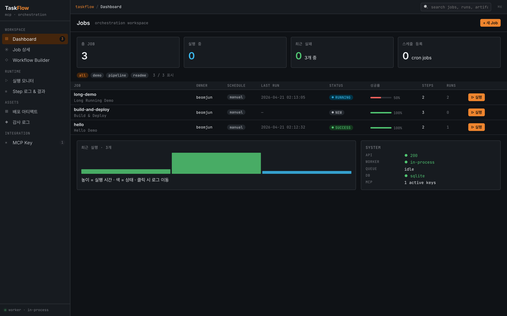
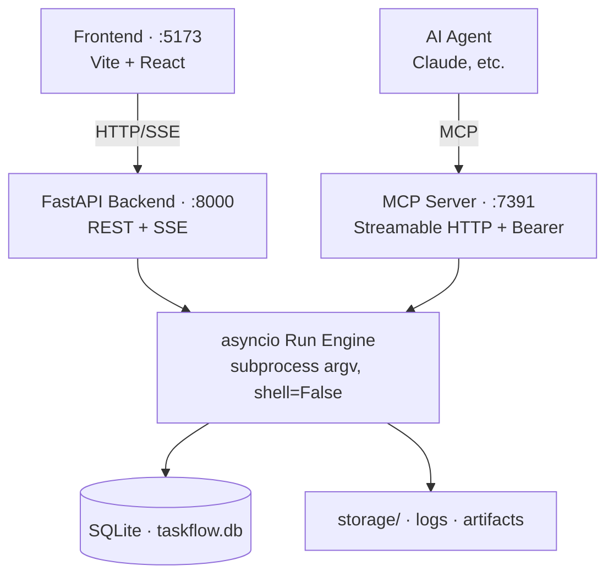
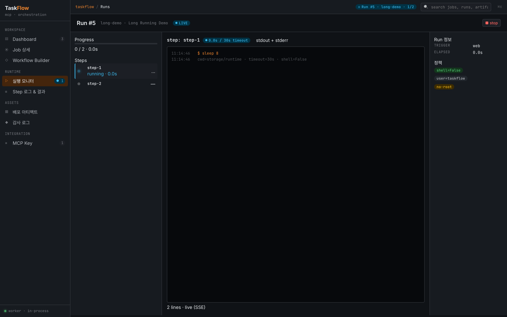

# TaskFlow MCP Server

**🌐 Language / 언어:** [한국어](./README.md) · [English](./README.en.md)


**AI Agent가 1차 사용자인 Workflow 오케스트레이션 플랫폼.** Scope 기반 권한과 hash-chained audit으로 Agent 실행을 통제하며, MCP(Model Context Protocol) 엔드포인트를 통해 Claude 등 Agent가 Job을 안전하게 실행할 수 있게 합니다.



## Architecture



Backend와 MCP 서버는 별도 프로세스이며, 각자 Run Engine을 내장한 채 같은 SQLite DB와 `storage/`를 공유합니다. MCP 호출이 REST API를 거쳐 가지는 않습니다.

## Quickstart

```sh
git clone <this-repo> taskflow-mcp-server
cd taskflow-mcp-server
make setup        # venv + npm + DB migrate
make dev          # backend:8000 · mcp:7391 · frontend:5173
```

브라우저로 `http://localhost:5173` 접속 → `+ 새 Job` → 실행. 빈 DB로 시작하므로 UI/MCP로 직접 Job·Key·Artifact를 만들면 됩니다.

자세한 튜토리얼은 [Getting Started](./docs/getting-started.md).

Run을 시작하면 Monitor 화면에서 SSE로 stdout이 실시간 스트림됩니다:



## 주요 특징

- **AI Agent First** — MCP 엔드포인트로 Agent가 Job을 직접 트리거, 결과는 구조화된 스키마(`status`, `steps[]`, `failed_step`, `params`, `outputs`, `logs_uri` 등)로 반환
- **Run 파라미터** — Job이 `params`(이름·기본값·패턴)를 선언하면 실행할 때마다 브랜치 같은 값을 넘길 수 있고, step은 `PARAM_<NAME>` 환경변수로 받음. 해석된 값은 Run에 고정 ([Run Params](./docs/run-params.md))
- **Run 출력값** — step이 stdout에 `::output key=value`를 찍으면 Run 기록(`outputs`)에 남음. "마지막으로 성공한 배포의 커밋" 같은 값을 `list_runs`로 바로 조회 ([Run Outputs](./docs/run-outputs.md))
- **Controlled execution** — `shell=False`(argv 리스트 전용), 제어된 cwd(`TASKFLOW_STEP_CWD` 기본 + Step별 `cwd`), `cd`/`pushd`/`popd` 거부. 실행 가능한 명령 자체는 제한하지 않고 Job 작성 REST API에는 인증이 없으므로, 네트워크 접근 제어와 hash-chained audit으로 통제 ([Security](./docs/security.md))
- **Observable** — SSE로 실시간 stdout/stderr 스트림, 출력 문자열 기반 Step 성공/실패 판정, Workflow DAG 시각화(DAG · List · Timeline 3뷰)
- **Immutable audit** — append-only hash-chained 감사 로그, `/api/audit/verify`로 무결성 검증
- **MCP 통제** — Key별 scope(`run:<job-id>` / `read:*` / `write:uploads` 등) + Key별 분당 rate-limit + 발급/revoke 감사 기록

## Documentation

| 문서 | 내용 |
|---|---|
| [Getting Started](./docs/getting-started.md) | 설치 · 첫 Job 만들기 · Step 작업 디렉토리(cwd) |
| [Artifacts](./docs/artifacts.md) | 업로드 · Job에서 alias 선언 · step에서 `ARTIFACT_*` 사용 · 버전 고정 |
| [Artifact Jobs](./docs/artifact-jobs.md) | 아티팩트를 쓰는 Job 작성법 · 판정/실패 처리 · 안티패턴 |
| [Run Params](./docs/run-params.md) | 실행 시 값 전달(브랜치 등) · Job에서 선언 · step에서 `PARAM_*` 사용 |
| [Run Outputs](./docs/run-outputs.md) | step이 `::output key=value`로 Run에 값 기록(배포 커밋 등) · 마지막 성공 Run 값 조회 |
| [MCP API](./docs/mcp-api.md) | Key 발급 · JSON-RPC 호출 · 도구 목록 · Claude Desktop 연동 |
| [REST API](./docs/rest-api.md) | 엔드포인트 · SSE 이벤트 포맷 · 오류 코드 |
| [Operations](./docs/operations.md) | 실행 모드(A/B/C) · 네트워크 바인딩 · 프로덕션 릴리즈 · 환경변수 |
| [Security](./docs/security.md) | `shell=False` · 제어된 cwd · `SECRET_*`/예약 환경변수 · hash-chained audit |
| [Troubleshooting](./docs/troubleshooting.md) | 자주 발생하는 증상과 해결 |
| [Design Docs](./docs/00-overview.md) | 프로젝트 배경 · 도메인 규칙 · 시스템 스펙 (`00` → `03` 순서) |

## 테스트

```sh
make test
```

pytest — 주요 항목:

- `test_audit_chain.py` — 10개 이벤트 체인 intact, 1 row 위변조 탐지
- `test_dag.py` — topo sort, 비순환 검증, 중복 id/shell 문자열 거부
- `test_policies.py` — `cd`/`pushd`/`popd` 거부, 그 외 명령은 통과, 빈 argv no-op
- `test_job_policy_api.py` — 임의 명령(`/bin/bash`·`rm`·`docker`) Job 저장 허용, `cd`는 400 + `policy.violation` DENY 기록
- `test_scope.py` — 정확 매칭 / wildcard / read-only가 run 거부
- `test_rate_limit.py` — 10/min 버스트 후 11번째 호출 시 `retry_after`
- `test_artifact_refs.py` · `test_artifact_refs_api.py` — alias 해석 · `@latest` 고정 · `UNKNOWN_ALIAS`/`MISMATCH`/`INVALID_ARTIFACT`/`NOT_READY`
- `test_run_params.py` · `test_run_params_api.py` — 파라미터 선언 검증 · 기본값 · `pattern` 전체 일치 · `UNKNOWN_PARAM`/`INVALID_PARAM` · step `env`로 덮어쓰기 불가
- `test_run_outputs.py` — `::output` 파싱 · SUCCESS로 끝난 step 값만 기록 · 덮어쓰기
- `test_worker.py` · `test_run_engine_*.py` — subprocess 실행 · 출력 assertion · 취소 · 실행 시점 정책 재검증

일부 테스트는 POSIX 환경(`/bin/sh`, 파일 권한 등)을 전제로 하므로 Windows에서는 플랫폼 차이로 실패할 수 있습니다.

## 범위에서 제외

현재 스프린트 범위 밖으로 의도적으로 제외한 기능:

- 복잡한 RBAC/ABAC UI, multi-workspace / multi-tenant
- Workflow GitOps import/export
- 알림 채널 구성 (Step의 notify argv로 대체)
- 분산 Worker 스케줄러 (in-process, 동시성 1)
- cron 스케줄 실행 — Job의 `schedule` 값은 저장·표시만 되고, 이를 발화하는 스케줄러는 없음
- Job 전체 `timeout` 강제 — 현재는 Step별 `timeout`만 적용
- MCP Key 회전(rotate) — revoke 후 재발급으로 대체
- ClamAV 실제 연동 (현재 stub — 업로드 즉시 READY)
- SIEM forward 파이프라인 (로컬 audit만)
- 실 `ROLLBACK` 정책 (MVP는 `STOP`으로 수렴)
- PostgreSQL / S3 전환 (Alembic 경로만 열려있음)
- `stream` 모드의 MCP `run_job` (REST SSE 대체 사용)

자세한 근거는 [docs/00-overview.md §5.2](./docs/00-overview.md).

## Contributing

개발 셋업은 [Getting Started](./docs/getting-started.md), 테스트 실행은 위 섹션 참고. PR 전에 `make test`가 통과하는지 확인해 주세요.

## License

MIT — [LICENSE](./LICENSE) 참조.
