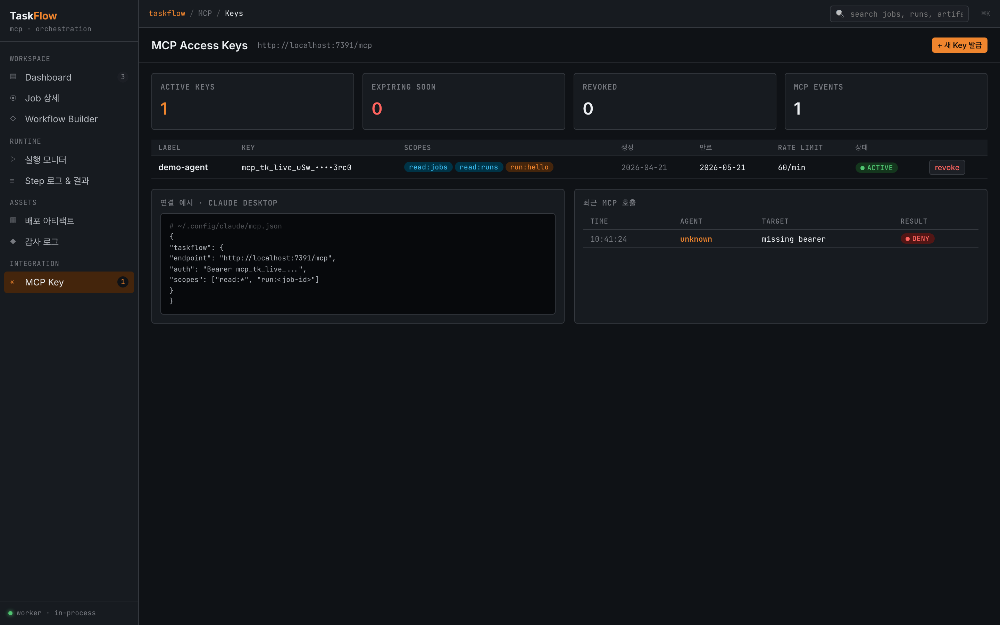

# MCP API

The TaskFlow MCP server runs on **Streamable HTTP transport**. All calls require an `Authorization: Bearer <token>` header.

- Base URL: `http://localhost:7391/mcp`
- Protocol: JSON-RPC 2.0 (`initialize` → `notifications/initialized` → `tools/call`)
- Auth: pass the MCP Key plaintext as the Bearer token

## 1. Issuing an MCP Key



### Via UI

`MCP Key` screen → `+ Issue Key` → select Label / Scope / Expiry / Rate limit. **The key is shown only once immediately after issuance** — copy it somewhere safe.

### Via CLI

```sh
curl -s -X POST http://localhost:8000/api/keys \
  -H "Content-Type: application/json" \
  -d '{
    "label": "test-agent",
    "scopes": ["read:jobs", "read:runs", "run:hello"],
    "expires_days": 30,
    "rate_limit": "60/min"
  }'
```

Example response:

```json
{
  "id": "k_...",
  "label": "test-agent",
  "plaintext": "mcp_tk_live_xxxxxxxxxxxxxxxxxxxxxxx",
  "scopes": ["read:jobs", "read:runs", "run:hello"],
  ...
}
```

The `plaintext` value is available **only at this moment**. Only a hash is stored in the DB.

## 2. Scope Rules

| Scope | Meaning |
|---|---|
| `read:jobs` / `read:runs` / `read:*` | Read-only tools only |
| `run:<job-id>` | Run a specific job |
| `run:*` | Run any job |
| `write:uploads` | Upload artifacts |

Matching rule: a call is allowed when the key holds exactly the required scope, or the `<ns>:*` wildcard of the same namespace (`run:*`, `read:*`, …). Calling `run_job` with a read-only key returns the tool error `DENY: scope 'run:<job_id>' not permitted` and records an `auth.fail` (result=DENY) audit event — this is an error inside the JSON-RPC response, not an HTTP 403 (§4.1).

## 3. Direct JSON-RPC Calls

The server runs Streamable HTTP in **stateless** mode with JSON responses. Every request is handled on its own, so no `Mcp-Session-Id` is issued or required, and `tools/list` / `tools/call` work without a prior `initialize`. Regular MCP clients start with `initialize`, which works too.

```sh
TOKEN="mcp_tk_live_...(issued plaintext)..."

# 1) list available tools
curl -X POST http://localhost:7391/mcp \
  -H "Content-Type: application/json" \
  -H "Accept: application/json, text/event-stream" \
  -H "Authorization: Bearer $TOKEN" \
  -d '{"jsonrpc":"2.0","id":1,"method":"tools/list","params":{}}'

# 2) run_job (sync mode)
curl -X POST http://localhost:7391/mcp \
  -H "Content-Type: application/json" \
  -H "Accept: application/json, text/event-stream" \
  -H "Authorization: Bearer $TOKEN" \
  -d '{"jsonrpc":"2.0","id":2,"method":"tools/call","params":{
       "name":"run_job",
       "arguments":{"job_id":"hello","mode":"sync"}}}'

# 3) pass values to a Job that declares params (async mode)
curl -X POST http://localhost:7391/mcp \
  -H "Content-Type: application/json" \
  -H "Accept: application/json, text/event-stream" \
  -H "Authorization: Bearer $TOKEN" \
  -d '{"jsonrpc":"2.0","id":3,"method":"tools/call","params":{
       "name":"run_job",
       "arguments":{"job_id":"be-deploy","mode":"async","params":{"branch":"feature/x"}}}}'
```

`run_job(mode=sync)` blocks until the run finishes and returns the following JSON (the agent schema) in `content[0].text`. `get_run`, `list_runs` and `cancel_run` return the same shape:

```json
{
  "run_id": 4821,
  "job_id": "hello",
  "status": "SUCCESS",
  "started_at": "...",
  "finished_at": "...",
  "duration_sec": 1.02,
  "artifact_refs": {},
  "params": {},
  "outputs": {},
  "steps": [
    {"id": "greet", "state": "SUCCESS", "elapsed_sec": 0.002},
    {"id": "wait",  "state": "SUCCESS", "elapsed_sec": 1.01}
  ],
  "failed_step": null,
  "err_message": null,
  "logs_uri": "taskflow://runs/4821/logs"
}
```

| Field | Contents |
|---|---|
| `status` | `RUNNING` / `SUCCESS` / `FAILED` / `TIMEOUT`. A cancelled run is `FAILED` with `err_message: "사용자 취소"` |
| `artifact_refs` | The `{ref, sha256}` pinned per alias ([Artifacts](./artifacts.en.md)) |
| `params` | Every param value pinned on the run, defaults included ([Run Params](./run-params.en.md)) |
| `outputs` | Values steps recorded with `::output key=value` ([Run Outputs](./run-outputs.en.md)) |
| `steps[].state` | `PENDING` / `RUNNING` / `SUCCESS` / `FAILED` / `TIMEOUT` / `SKIPPED` |
| `logs_uri` | An identifier. Fetch the log text with `get_run_logs(run_id, step_id)` |

At the same time, `mcp.run` (src=mcp) and `job.run.done` (or `job.run.fail`) events are recorded in the `audit` table.

## 4. Tool List

| Tool | Required Scope | Description |
|---|---|---|
| `list_jobs` | `read:jobs` | List all jobs |
| `get_job(job_id)` | `read:jobs` | Job details |
| `list_runs({job_id?, status?, limit?})` | `read:runs` | Query run history (newest first, `limit` default 20, max 200). Each item is the agent schema — "outputs of the last successful run" is `list_runs(job_id=…, status="SUCCESS", limit=1)` |
| `get_run(run_id)` | `read:runs` | Run status/result (agent schema, incl. `params` and `outputs`) |
| `get_run_logs(run_id, step_id, {tail?})` | `read:runs` | Step log text (`tail` default 200 lines) |
| `subscribe_run(run_id, {tail?})` | `read:runs` | Recent event snapshot from this MCP server process's log_bus (not a stream) |
| `upload_artifact(name, version, content_base64, {ext?})` | `write:uploads` | Upload artifact (base64 encoded) |
| `get_artifact(name, version)` | `read:jobs` | Artifact status. `version` may be `latest` |
| `run_job(job_id, {mode, artifact_refs?, params?, idempotency_key?})` | `run:<job_id>` | Trigger a run. `mode`: `sync` / `async`. `artifact_refs` is `{alias: "uploads://<name>@<ver\|latest>"}`; omitted aliases resolve to `@latest` and are pinned to the concrete version. `params` is `{name: value}`, only accepts params the Job declares, and omitted params use their default ([Run parameters](./run-params.en.md)). See `get_job`'s `params` for the declaration |
| `cancel_run(run_id)` | the run's `run:<job_id>` | Cancel a running run |

`list_jobs` / `get_job` return the full Job definition, including `steps[].env` — see the caveat in [Security](./security.en.md#3-secret_-environment-variables).

### 4.1 Error Responses

Only authentication and rate-limit failures come back as HTTP statuses.

| HTTP | Body | When |
|---|---|---|
| `401` | `{"error": "UNAUTH", "detail": "missing bearer" \| "invalid key" \| "expired key"}` | No Bearer · no matching ACTIVE key (revoked included) · expired |
| `429` | `{"error": "RATE_LIMIT", "retry_after": N}` + `Retry-After` header | The key's per-minute call budget is exhausted |

Every other failure is a **tool error** (`isError: true`) inside an HTTP 200 JSON-RPC response, with text of the form `<CODE>: <message>`.

| Code | When |
|---|---|
| `DENY` | Key scope does not match (`auth.fail` audit recorded) |
| `NOT_FOUND` | job/run/artifact/log does not exist |
| `CONFLICT` | The job is already running (`… already running as #<run_id>`) · `idempotency_key` used by another job · artifact `name@version` already exists |
| `NOT_RUNNING` | `cancel_run` target is not running |
| `UNKNOWN_ALIAS` / `MISMATCH` / `INVALID_ARTIFACT` / `NOT_READY` | Artifact reference resolution failed ([Artifacts §5](./artifacts.en.md#5-error-codes)) |
| `UNKNOWN_PARAM` / `INVALID_PARAM` | Param resolution failed ([Run Params §4](./run-params.en.md#4-error-codes)) |

A trigger rejected for a reference or param creates no run and records an `mcp.run` (result=DENY) audit event.

## 5. Run Modes

- **`sync`** (default): Waits until the run completes and returns the agent schema. If `TASKFLOW_MCP_MAX_SYNC_SEC` (default 600s) is exceeded, returns `{run_id, status:"RUNNING", degraded_to:"async"}`
- **`async`**: Returns `{run_id, status:"RUNNING", poll_url}` immediately → poll with `get_run(run_id)` afterward

The run executes inside the MCP server process that received the call. Its live events exist only in that process, so a run triggered over MCP cannot be followed through the backend's `GET /api/runs/{id}/stream` (SSE) — use `get_run` polling or `subscribe_run` instead.

## 6. Idempotency

Passing an `idempotency_key` to `run_job` will **return the existing run** instead of creating a new one on re-invocation with the same key (backed by `Run.idempotency_key` unique index in the DB). Keys never expire, so a key always points at its first run no matter how much time has passed. `artifact_refs` and `params` on the repeated call are ignored.
The key is unique table-wide, so **each job needs its own key.** Reusing one under a different job is rejected with `CONFLICT` rather than returning that job's run.

## 7. Claude Desktop Integration

Recent versions of Claude Desktop support HTTP MCP transport. Config file location varies by distribution:

- macOS: `~/Library/Application Support/Claude/claude_desktop_config.json`
- Linux/Windows: `~/.config/claude/mcp.json` family

```json
{
  "mcpServers": {
    "taskflow": {
      "url": "http://localhost:7391/mcp",
      "headers": {
        "Authorization": "Bearer mcp_tk_live_..."
      }
    }
  }
}
```

After restarting Claude Desktop, tools like `list_jobs` will be available in the chat.

> Some Claude Desktop distributions only support stdio transport. In that case, write a separate bridge process or connect directly using the official MCP client library (`@modelcontextprotocol/sdk`, `mcp` Python).

## Troubleshooting

For MCP-related errors, see the MCP section in [Troubleshooting](./troubleshooting.en.md).
