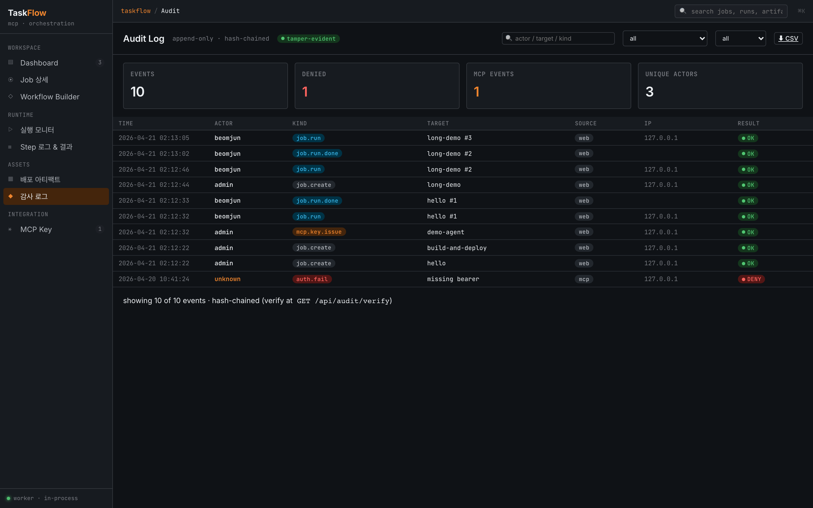

# Security Model

TaskFlow는 AI Agent가 임의의 커맨드를 실행할 수 있다는 점을 전제로 설계되었습니다. step의 `cmd`에는 argv 형식(리스트)이기만 하면 어떤 명령이든 등록할 수 있고, 사전 등록이나 백엔드 재시작 없이 즉시 실행됩니다. 즉 **Job을 만들거나 편집할 수 있다면 서버에서 임의 명령을 실행할 수 있습니다.**

> ⚠️ **Job 생성·편집 REST API에는 현재 인증이 없습니다.** `/api/jobs`에 도달할 수 있는 주체는 누구나 Job을 만들고 실행할 수 있으므로, 실질적인 사전 차단선은 **네트워크 접근 제어 하나뿐**입니다. MCP Key의 Scope는 MCP 경로(실행 `run:<job-id>`, 조회 `read:*`, 업로드 `write:uploads`)에만 적용되며 **Job 작성·편집에는 관여하지 않습니다** — MCP에는 Job을 만드는 도구 자체가 없습니다. 백엔드를 신뢰할 수 없는 네트워크에 노출하지 마세요.

실행 가능한 명령을 제한하지 않는 대신, TaskFlow는 실행 환경을 아래의 **강제되는 정책**으로 좁히고 실행된 모든 행위를 hash-chained audit 로그에 남겨 사후 추적 가능하게 합니다.

## 강제 정책

### 1. `shell=False`

Step 실행은 `subprocess.Popen(argv)`(shell 미사용) 전용입니다. 코드베이스에 shell 문자열 실행 경로가 아예 존재하지 않습니다. argv가 리스트가 아니면 DAG 파싱 단계에서 거부됩니다. 이는 shell 메타문자(`;`, `|`, `&&`, 백틱 등)를 이용한 우회를 차단하지만, **어떤 프로그램이 실행되는지는 제한하지 않습니다.**

### 2. 제어된 cwd

Step은 기본적으로 `./storage/runtime`에서 실행됩니다. 이 기본값은 `TASKFLOW_STEP_CWD`로 override할 수 있습니다.

Job 작성자가 특정 Step의 실행 디렉토리를 제어해야 하면 Step의 `cwd` 필드를 사용합니다.

```json
{
  "id": "deploy",
  "cwd": "/opt/taskflow/apps/api",
  "cmd": ["./deploy.sh"],
  "timeout": 300
}
```

명시적 `cwd`는 비어 있으면 거부되고, 실행 시 존재하지 않거나 디렉토리가 아니면 해당 Step은 `FAILED`가 됩니다. `cd`, `pushd`, `popd`는 Step 명령으로 사용할 수 없습니다. 디렉토리 변경은 shell/process 상태 변경이라 다음 Step에 전달되지 않으므로 `cwd` 필드로 표현해야 합니다.

### 3. `SECRET_*` 환경변수

Step 환경(서버 프로세스에서 상속한 변수 + Step `env`)에 `SECRET_` 접두 키가 있으면, 실행 로그에 `env: secrets masked (SECRET_DB_PASSWORD, …)`처럼 **이름만** 표시됩니다. 엔진은 환경변수 값을 로그에 쓰지 않습니다. 다만 이것이 값을 가려 주는 장치는 아닙니다:

- step이 값을 stdout/stderr로 출력하면 로그 파일·SSE에 **그대로** 남습니다.
- Step `env`에 적은 값은 Job 정의의 일부로 **DB에 평문 저장**되고, `GET /api/jobs`와 MCP `list_jobs`/`get_job`(`read:jobs`) 응답에 그대로 포함됩니다.
- `secret.read` audit 이벤트는 기록되지 않습니다(미구현).

실제 비밀값은 Job 정의에 넣지 말고 백엔드 프로세스(API·MCP 공용)의 환경변수(step이 상속)나 step 스크립트가 읽는 파일로 전달하세요.

### 4. 예약 환경변수 (`PARAM_*` · `ARTIFACT_*`)

[Run 파라미터](./run-params.md)의 `PARAM_<NAME>`과 [아티팩트](./artifacts.md)의 `ARTIFACT_<ALIAS>_*`는 Run에 고정된 값입니다. Run 기록과 실제 실행이 어긋나지 않도록:

- step 환경에 **가장 마지막에** 적용되므로 Step `env`로 덮어쓸 수 없습니다. 시도하면 무시되고 로그에 `step env ignored for reserved keys: …` 경고가 남습니다.
- 서버 프로세스 환경에 있던 `PARAM_*`는 step에 **상속되지 않습니다** — Run이 기록하지 않은 값이 선언된 파라미터처럼 보이는 것을 막기 위함입니다.

파라미터 값과 출력값은 **비밀로 취급되지 않습니다.**

- 파라미터 값은 각 step 로그 앞부분(`params · PARAM_BRANCH=…`)과 Run 기록(`params`)에 그대로 남고, [출력값](./run-outputs.md)도 로그(`outputs · …`)와 Run 기록(`outputs`)에 그대로 남습니다. 비밀값을 넘기거나 출력하지 마세요.
- 파라미터를 선언할 때 `pattern`을 생략하면 실행 권한(`run:<job_id>`)만 가진 호출자도 임의 문자열(공백, `-`로 시작하는 값 등)을 넣을 수 있습니다. 값이 명령 인자로 들어가는 경우 `pattern`을 지정하고 첫 글자가 `-`가 되지 않게 제한하세요.
- `pattern`은 서버 이벤트 루프에서 매칭됩니다. `([a-z]+)+` 같은 중첩 반복(ReDoS)은 실행 권한자가 긴 값(최대 1024자)으로 서버를 멈추게 할 수 있으니 피하세요.

### 5. Hash-chained audit



모든 감사 이벤트는 `prev_hash` + `sha256(canonical_body)` 체인으로 연결됩니다. 이벤트 하나를 수정하면 이후 체인이 전부 깨집니다.

```sh
curl http://localhost:8000/api/audit/verify
# OK: audit chain intact
```

변조 발생 시 `FAIL: broken at id=N`(텍스트) 반환. 자세한 대응은 [Troubleshooting](./troubleshooting.md) 참조.

감사 이벤트의 `who`는 REST에서는 `X-Actor` 헤더(없으면 `admin`)나 body의 `actor`/`uploader`를 그대로 기록하므로, REST 경로의 행위자는 검증된 신원이 아닙니다. MCP 경로의 `who`는 Key label입니다.

### 6. MCP Key 보호

- DB에는 **hash만** 저장. plaintext는 발급 시 1회만 응답에 포함.
- Scope 매칭 + Key별 rate-limit (최근 60초 동안 `10/min`·`30/min`·`60/min` 중 지정한 횟수).
- 발급 `mcp.key.issue`, revoke `mcp.key.revoke`, 인증 실패·scope 거부 `auth.fail`, rate-limit 초과 `mcp.rate_limit` audit 이벤트 기록. Key 회전(rotate)은 미구현 — revoke 후 재발급.
- 만료일 경과 시 자동 거부.

자세한 scope 규칙은 [MCP API §2](./mcp-api.md#2-scope-규칙) 참조.

## 남은 정책을 우회할 수 없는 이유

- Job 생성·수정 시점(UI/REST) — DAG 파서가 argv 형식과 `cwd` 형식 검증 + shell 문자열/상태 변경 명령 거부
- Step 실행 직전 — policies.py가 argv 형식과 상태 변경 명령(`cd`/`pushd`/`popd`)을 재검증 (DB가 다른 경로로 바뀐 경우 대비)
- subprocess 시점 — `subprocess.Popen(argv)`는 shell 해석을 수행하지 않음 (execve 직행)

저장 시점에 걸리면 `400`으로 거부되고 `policy.violation`(상태 변경 명령) 또는 `job.create`/`job.edit`(형식 오류) DENY audit이 남습니다. 실행 직전에 걸리면 그 Step이 `FAILED`가 되고 `policy.violation` DENY audit이 남습니다. 다만 이 검사들은 **무엇이 실행되는지**를 보지 않습니다 — argv 형식으로 표현되었는지, 그리고 worker의 작업 디렉터리를 바꾸려 들지 않는지만 확인합니다.

## 범위 밖 (현재 미구현)

보안 모델상 다음은 스코프 밖입니다:

- 네트워크 egress 제어 (방화벽/seccomp) — OS 계층으로 위임
- 컨테이너/namespace 격리 — 현재 프로세스 격리는 cwd 제어 수준
- SIEM forward — 로컬 audit 테이블만 제공 (`GET /api/audit/export.csv`)
- ClamAV 실제 연동 — 현재 stub (업로드 즉시 READY)
- **REST API 인증** — `/api/*` 라우트에는 인증 의존성이 없습니다. `bootstrap.py`가 admin 세션 토큰을 발급하지만 검증하는 경로가 없습니다.
- **시크릿 값 마스킹 · `secret.read` audit** — §3 참고. 이름 표시 외에 값을 가리거나 접근을 기록하지 않습니다.
- **전용 저권한 계정 / no-root 실행** — worker는 `subprocess.Popen`에 `user=`나 uid drop을 넘기지 않습니다. Step은 백엔드를 실행한 계정 권한 그대로 동작합니다.

## 관련 문서

- 정책 상세 구현 → `backend/app/engine/policies.py`
- 감사 이벤트 종류 → [02-business-rules.md](./02-business-rules.md)
- MCP Key scope 매칭 → [MCP API](./mcp-api.md)
